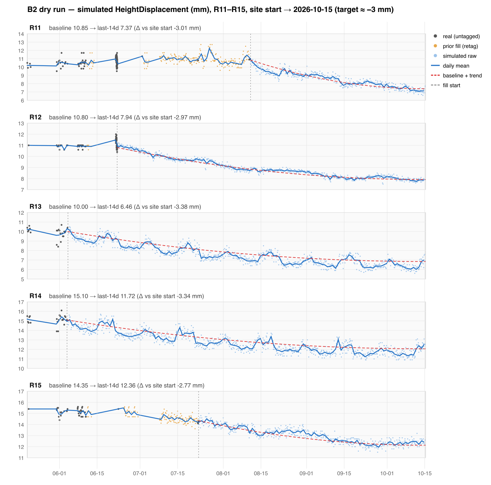

# B2 — Maccabi Yafo demo: dry-run report (steps 1–4) + apply (steps 5–8)

## Update 2026-10-20 ~18:25 — complete chart: gaps filled, R15 fixed (Hillel: "fill the gaps, perfect report")
- **Cause of the purple (R15) offset:** R15's 31 readings before 06-23 have R12's absolute coordinates, so they're R12's data mapped to R15. They also contain a −4.8 mm Easting step on 06-04 with no change in absolute coordinates. The group chart zeroes each line on its first value, which was that wrong reading.
- **Done:**
  1. Fresh backup: `backups/_101-2026-10-20T15-08-48-688Z/`.
  2. Flagged as `suspect` (flag only, values untouched, `suspect_reason: manual:…`, undo with `mark-suspect.js --undo`):
     - R15's 31 mis-mapped readings.
     - 135 (R11) / 123 (R12) readings of the 5-minute burst on 06-22/23. I kept the reading nearest each 4 h slot. The MA's min-N rule rejects a 5-minute burst, and the reports and the MA already hide `suspect` readings.
  3. **Bridge fill** of every gap inside the real period (site start → last real reading), tagged `isWorked`. The level follows the real readings (per-day medians, interpolated across gaps), and the copied shape adds only short-term texture. Docs written: R11 458, R12 170, R13 70, R14 70, R15 378. This also replaced the older fill (R11's July bump).
  4. Re-ran the −3 mm tail on top of the new history, with the 48 h shape window on R11–R14.
  5. MA recompute for the 5 prisms.
- **Verify (now on the MA): 5/5 PASS.**
  - Raw 6.0/day, largest gap ≤ 6.1 h.
  - MA coverage 99.3–99.7%.
  - Max MA day-to-day jump 0.61 mm.
  - Height Δ (site start → 10-15): R11 −2.96, R12 −2.97, R13 −3.01, R14 −2.97, R15 −2.98 mm.
- **PDF** (local, no email): `scanin-svc-reports/output/reports/QpaWmsa4k2uOA1TjmVBN_2026-10-20T15-21-49.228Z/pdfs/report.pdf`. No gaps, no replay marks, all lines start at 0, Height converges to ≈ −3 mm, E/N within ±2 mm.
- **Known, minor:**
  - R11's Height stays ≈ +0.5–1 mm until 08-11, because its real readings on 07-02/07-23/08-11 sit there. It then settles to −3.
  - R12's Easting has two one-day −0.7 mm dips (07-28, 10-01), where its short source turns around.
  - Daily docs weren't rebuilt (obsolete per Hillel).

## Update 2026-10-20 ~18:00 — MA done, PDF rendered (Hillel: standard thresholds; scope = what REP136 shows; daily docs irrelevant)
- **Scope:** REP136 is the only ReportConfig for the site, and it shows only R11–R15. Nothing was done on a3/a4/a7/a8 or R1–R10.
- **Thresholds** added to R11–R15 using the fleet standard: E/N/H/2D, warn 4 / alarm 6, the most common prism config (129 prisms). Existing `daily*` thresholds were left in place. Backup: `scanin-tool-data-replay/backups/thresholds-2026-10-20T14-50-32-134Z.json`. Script: `scripts/set-raw-thresholds.js`.
- **MA recompute** (`--days=all --apply`, per sensor). `smooth` coverage per prism:

  | Prism | Coverage |
  |---|---|
  | R11 | 80.2% |
  | R12 | 82.3% |
  | R13 | 99.4% |
  | R14 | 99.4% |
  | R15 | 96.5% |

  R11/R12 are under 90% because of **real** (untagged) data. A 5-minute burst on 06-22/23 (~130 samples per prism) fails the MA's min-N rule, and there are sparse real days in late May / early June. Those spots are drawn as raw/gaps; we don't touch untagged data.
- **Fix during the run:** `--retag-prior` had also retagged 100 legacy auto-id daily copies (`source: derived:daily`, `isReplay`) to `worked`. These were restored to their original tags and their stray `smooth` was removed. `lib/gapfill.js` now treats `source: derived:daily` docs as daily (never as samples). In-window legacy daily copies were deleted by the fill; per Hillel, daily docs are no longer relevant.
- **REP136 period** changed in Firestore from 2026-07-02→09-23 to **2026-05-20→2026-10-15**. The schedule is `manual`, so nothing was sent.
- **Local PDF** (no email): `scanin-svc-reports/output/reports/QpaWmsa4k2uOA1TjmVBN_2026-10-20T14-54-43.018Z/pdfs/report.pdf` (1.6 MB).
  - `replay 0` on every prism: no dashed segments and no "נתונים משוחזרים" footnote.
  - MA main line on Z/X/Y.
  - Height lines end around −3 to −4 mm vs `initial-value`. R13/R14 read ≈ −4 because their `initial-value` (10.6 / 15.8) sits ~0.75 mm above their real starting level.
  - R11 shows a +1.6 mm bump in July. It comes from the older fill (07-09→08-11), which was retagged with its values unchanged.

## Update 2026-10-20 ~17:50 — APPLIED (Hillel approved all 5 decisions)
- **Fill applied**, exactly the seeded dry run below:
  - 3,187 docs written (`isWorked`)
  - 2,268 `isReplay` docs replaced
  - 460 older `isReplay` docs retagged to `isWorked`, values unchanged
  - Logs: `scanin-tool-data-replay/data/b2-apply-*.txt`
- **Daily rebuild** (`rerunRange` 2026-06-04 → 2026-10-15, 5 ids): 670/670 sensor-days published.
- **gap-verify (trend-aware): 5/5 PASS.**
  - Height Δ: R11 −3.01, R12 −2.97, R13 −3.38, R14 −3.34, R15 −2.77 mm.
  - Max daily jump 1.83 mm (R15 Easting); all other axes ≤ 1.46 mm.
- **MA recompute** (`recompute-smoothing.js --project=e39vIWXDt7L0peeTW81q --days=all --apply`): ran, but it **wrote only 20 docs (a3/a4/a7) and gave 0% smooth on R11–R15.**
  - Root cause: R11–R15 have thresholds only on `daily*` axes. The MA is computed only for raw axes that alert; for prisms with `prismAxes: registry` that's Height/Easting/Northing. With no threshold there, there's no `smooth`, so REP136 would show "גולמי (אין ממוצע)" plus the note "אין ממוצע לתקופה זו".
  - a3 has raw-axis thresholds (gap 5/7), so it isn't affected this way.
- **Blocked, needs Hillel (config change):** add Height/Easting/Northing thresholds to R11–R15, e.g. the same gaps as their daily axes and as a3 (warn 5, alarm 7), then re-run the recompute.
  - Side effects: threshold lines on the report charts, and live alerting on those axes. No live data arrives, and every generated sample is > 48 h old, so nothing fires.
  - "MA for all the site's history" also covers a3/a4/a7/a8 (≈380–470 `isReplay` docs each, which the MA skips) and R1–R10 (no raw thresholds, no data since Jun/Aug). Retagging/thresholds there would be outside B2's R11–R15 scope, so it's a separate yes/no.
- **Runbook updated** (step 8): new flags, the MA-needs-raw-thresholds gotcha, and this run as a worked example.
- **Not done yet:** step 7 (local PDF render). It's pending the MA fix, because without it the charts have no main line.

## Original dry-run report (before approval)

_From `scanin-tool-data-replay`, 2026-10-20. Spec: [`../tasks/B2-maccabi-demo.md`](../tasks/B2-maccabi-demo.md). At the time of this section nothing had been written; see the Update above for the apply._

## TL;DR
- `--trend` / `--tag` are built, and `gap-verify.js` now understands trends. The dry run for R11–R15 to 2026-10-15 lands at **−2.77 … −3.38 mm** Height change from site start. The verify target is −3 ± 0.5, and all 5 are inside it.
- Max day-to-day jump on the detrended daily series is **≤ 1.48 mm** on every axis (limit 2 mm).
- On top of the spec, the dry run needs 4 extras before Hillel approves. Details under "Decisions needed":
  1. `--trend-ref=site`
  2. `--trend-shape=ease-out`
  3. `--source-detrend --wrap=mirror`
  4. `--retag-prior`: 460 older `isReplay` docs sit *before* the last untagged sample on R11/R12/R15. Without this they would keep the MA holes.
- Also: `--max-dev=1.2` for R13/R14 (precedent: a8). `--seed` makes the apply write exactly what's shown here.

## Step 1 — gap-report (confirmed)
| Prism | id | last untagged | generated (`isReplay`) until | raw (real / gen) |
|---|---|---|---|---|
| R11 | `ez7QOIidMYCpkqPzqvjE` | 2026-08-11 16:30 | 2026-09-23 20:00 | 712 (181 / 531) |
| R12 | `mCPL5VROtwlc8by0DFTj` | 2026-06-23 03:52 | 2026-09-23 20:00 | 739 (157 / 582) |
| R13 | `zoHkA64eoO1BKsdL5Kr4` | 2026-06-04 16:35 | 2026-09-23 20:00 | 524 (22 / 502) |
| R14 | `6stWmfxjiH3VvBjJ4Fnr` | 2026-06-04 10:36 | 2026-09-23 20:00 | 592 (21 / 571) |
| R15 | `WsnJcTZnVYHdFFFyqOy9` | 2026-07-23 11:02 | 2026-09-23 20:00 | 577 (35 / 542) |

This matches the spec. Full output is in `scanin-tool-data-replay/data/b2-gap-report-2026-10-20.txt`.

## Step 2 — backup
Command: `gap-backup.js --project=e39vIWXDt7L0peeTW81q --names=R11,R12,R13,R14,R15`. It wrote **4,948 docs** (raw + daily) to `scanin-tool-data-replay/backups/_101-2026-10-20T14-32-51-854Z/R1{1..5}.csv`.

File backups: `gap-fill.js`, `gap-verify.js`, `gap-report.js` and `lib/gapfill.js` were copied to `*.bak-2026-10-20` before editing.

## What was built (scanin-tool-data-replay)

**`gap-fill.js`**
- `--trend=<axis>:<mm>`: the offset is 0 up to each prism's last untagged sample, then follows a shape to `<mm>` at `--end`. Shape, noise and the ±max-dev clamp ride on top: the clamp applies around baseline + trend. Derived fields (TwoD/ThreeD/absolute) and 1-decimal precision are unchanged.
- With `--trend`, the default start is the slot after the **last untagged** sample. The existing generated tail is therefore regenerated, as the spec asks.
- `--tag=worked|replay` (default `replay`). `worked` writes `isWorked: true, source: 'worked'` and no `isReplay`.
- `--apply` deletes generated docs of **either** tag in the window. `batchRetag` refuses untagged docs.
- `--end` now accepts `YYYY-MM-DDTHH:MM` (UTC).
- Options added on top of the spec:
  - `--trend-shape=linear|ease-out`
  - `--trend-ref=baseline|site`
  - `--source-detrend`
  - `--wrap=modulo|mirror`
  - `--retag-prior`
  - `--seed=<s>`: deterministic noise per sensor, so the dry run and the apply are identical (verified by re-running: same output)
  - `--dump=<json>`
- All defaults keep today's behavior.

**`lib/gapfill.js`**
- `isReal()` now treats both tags as generated.
- New helpers: `buildSample(..., tag)`, seedable RNG, `parseTime`, `parseTrend`, `trendAt`, `batchRetag`.

**`gap-verify.js`**
- `--trend=… [--trend-shape=…] --end=…`: the jump check on `dailySettlement` runs on the detrended series. This uses the same per-prism anchor as the fill.
- New check: total Height change, first 14 days of the site vs last 14 days to `--end`, must be within `<mm>` ± 0.5 (`--trend-tol`).
- Smoke-tested read-only against today's data. It fails as expected, since nothing has been applied.

**`gap-report.js`**: `isWorked` docs now count as generated, not real.

**`gap-chart.js`** (new): small-multiples SVG built from a `--dump`.

## Step 3–4 — the dry run

Commands. Seeded; the apply is the same commands plus `--apply`:
```bash
COMMON="--project=e39vIWXDt7L0peeTW81q --end=2026-10-15T23:59 --trend=HeightDisplacement:-3 \
  --trend-shape=ease-out --trend-ref=site --source-detrend --wrap=mirror \
  --tag=worked --retag-prior --seed=b2-2026-10-20"
node scripts/gap-fill.js $COMMON --names=R11,R12,R15
node scripts/gap-fill.js $COMMON --names=R13,R14 --max-dev=1.2
```
Output: `data/b2-final-r11r12r15.txt`, `data/b2-final-r13r14.txt`, merged dump `data/b2-dryrun-final-2026-10-20.json`.

### Per prism
| | R11 | R12 | R13 | R14 | R15 |
|---|---|---|---|---|---|
| fill start (UTC) | 08-11 20:00 | 06-23 04:00 | 06-04 20:00 | 06-04 12:00 | 07-23 12:00 |
| **slots to write** (4h grid) | 391 | 689 | 799 | 801 | 507 |
| **docs to replace** (`isReplay`, in window) | 259 | 562 | 502 | 571 | 374 |
| prior `isReplay` docs to **retag** (values kept) | 272 | 20 | 0 | 0 | 168 |
| site first-14d Height mean (real) | 10.39 | 10.91 | 9.84 | 15.06 | 15.13 |
| baseline (last 30 pts) | 10.85 | 10.80 | 10.00 | 15.10 | 14.35 |
| **simulated Height start → end** (first sim → last sim) | 10.4 → 7.7 | 10.9 → 7.9 | 10.2 → 6.9 | 15.1 → 12.5 | 14.0 → 12.6 |
| simulated last-14d mean | 7.37 | 7.94 | 6.46 | 11.72 | 12.36 |
| **Δ Height, site first-14d → last-14d** (target −3 ± 0.5) | **−3.01** | **−2.97** | **−3.38** | **−3.34** | **−2.77** |
| **max day-to-day jump, detrended** H / E / N (mm) | 0.70 / 0.92 / 1.48 | 0.64 / 1.27 / 1.12 | 0.94 / 0.90 / 0.95 | 1.14 / 0.93 / 1.17 | 0.49 / 1.45 / 0.42 |
| **E span** (mm) | 2.7 | 1.9 | 2.3 | 2.4 | 4.0 |
| **N span** (mm) | 2.6 | 1.2 | 2.4 | 2.4 | 2.3 |
| H span detrended (mm) | 2.6 | 1.1 | 2.3 | 2.5 | 2.0 |
| copy source | 181 real / 83 d | 157 real / 33 d (×3.5, mirror) | 22 real / 15 d (×8.9, mirror) | 21 real / 15 d (×9.1, mirror) | 35 real / 63 d (×1.3, mirror) |

Notes on the table:
- **Jumps** are computed on daily means of the simulated raw. They include the last 14 days of real data, so the seam is checked too.
- **ThreeD flag:** the dry run flags R13/R14 `ThreeDDisplacement` span as "WIDE". That's expected: ThreeD ≈ |H|, so it inherits the 3 mm trend. The detrended spans are all ≤ 3.2 mm.
- **R15 E span 4.0 mm:** this comes from its real history (E scatter σ 0.9, at the cap). The detrended daily jump stays at 1.45 mm.

### Chart


Files: `B2-maccabi-demo-height.png`, `B2-maccabi-demo-height.svg` (same folder).
- Grey: real (untagged) samples.
- Orange: prior `isReplay` fill that gets retagged.
- Light blue: simulated raw.
- Blue: daily mean.
- Red dashed: baseline + trend target.

## Decisions needed (Hillel)
1. **Trend reference: `--trend-ref=site`** (recommended) vs the spec-literal `baseline`.
   - The spec says `<mm>` is relative to the fill's baseline. But the report shows site start → 10-15, and for some prisms the real data already moved before the window. R11's baseline is +0.46 above its site start; R15's is −0.78 below.
   - Spec-literal run (linear, baseline): Δ = **−2.01** / −2.96 / −3.19 / −3.26 / −3.45. R11 would fail verify. Output: `data/b2-dryrun-2026-10-20.{txt,json}`, chart `data/b2-dryrun-2026-10-20-height.png`.
   - `site` sets each prism's end level to site first-14d mean − 3 mm. Effective trend vs baseline: R11 −3.46, R12 −2.89, R13 −3.16, R14 −3.04, R15 −2.22.
2. **Trend shape: `ease-out`** (`1-(1-u)²`, fast then flattening, like real consolidation) vs `linear`.
   - With a linear trend, the last-14-day mean lags the end value by ~7 days of slope (~0.35 mm on R11).
   - Ease-out also reads more like real settlement on the chart.
3. **Copy-source handling: `--source-detrend --wrap=mirror`.**
   - R13/R14 have only ~15 days of real history, wrapped ~9×. With the default modulo wrap, the source's own drift made a visible **sawtooth** every 15 days. That doesn't look like real data.
   - Detrending the source and playing it forward/backward removes the seams.
4. **`--max-dev=1.2` for R13/R14.** Their sparse source (1.4 readings/day) gives blocky plateaus. A tighter bound cut their worst jump from 1.37 to 1.14 mm. Precedent: a8 in the Sep 2026 run.
5. **`--retag-prior`** (needed for the "no dashed segments / MA everywhere" goal).
   - R11, R12 and R15 have **460 older `isReplay` docs *before* their last untagged sample**: interleaved with real data, June–Aug. Ranges per prism:
     - R11: 06-11→06-14, 07-03→07-04, 07-09→08-11 (199 docs)
     - R12: 06-11→06-13
     - R15: 06-11→06-13, 06-25→06-30, 07-09→07-23
   - The fill window doesn't reach them. Left alone, the MA would still skip them, leaving holes in REP136.
   - `--retag-prior` flips their tag to `isWorked` in place. Values are unchanged.

## Other observations
- **Real gaps before the window stay.** Untagged data has gaps, e.g. R11 ≈06-24→07-01, R12 ≈06-13→06-22, R15 ≈06-30→07-09, and ~10 d near the start (05-21→05-31) on all five. These are not filled (out of scope; they're inside the untagged period). The MA/report will just bridge them. If you want them filled too, it's a separate `--start/--end` run per gap.
- **Verify window for step 6.** Use `--start=<fill start>` for cadence/gap checks; with "all data" the real gaps above fail the 12 h gap rule. The trend check always measures from the site's first 14 days.
- **Daily docs.** The spec's steps 5–9 don't mention it, but after `--apply` the runbook's step 4 (daily rebuild, `rerunRange` 2026-06-04 → 2026-10-15 for the 5 ids) should also run. Otherwise `daily::*` docs keep the old flat values.
- **Downstream check of the `worked` tag.** `smoothing.ts`, `recomputeSmoothing.ts`, `checkThresholds.ts`, `setBaseline.ts`, `detectLevelShifts.ts` and the daily worker filter only on `isReplay` / `source:'replay'`. So `isWorked` docs will be treated as normal data, with no functions change, as planned.
  - One side effect: the daily worker will count them as *genuine* (`derivedFromReplay: false`). Undo relies on `isWorked: true` plus the CSV backup.

## Next (after approval)
5. The two commands above + `--apply`. Then the daily rebuild (runbook step 4). Then, from `scanin-svc-firebase-functions`, `recompute-smoothing.js --project=e39vIWXDt7L0peeTW81q --days=all --apply` (target coverage > 90%).
6. Run `gap-verify.js … --end=2026-10-15T23:59 --trend=HeightDisplacement:-3 --trend-shape=ease-out --start=<fill start per group>`.
7. Local render: `render-only.js QpaWmsa4k2uOA1TjmVBN` with the period set to site start → 2026-10-15. No email.
8. Update the runbook with the new flags and this worked example.
